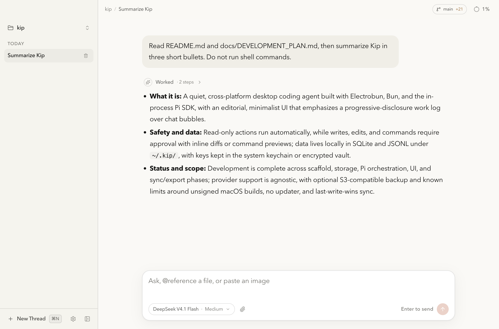

# Kip

A quiet, cross-platform desktop assistant for coding and everyday work, built with **Electrobun**, **Bun**, and **Pi**.

Kip keeps the agent in-process, persists every thread as portable JSONL, and puts an
explicit approval boundary between the model and your files. The interface borrows
from editorial design and Braun-era industrial minimalism: warm paper, obsidian,
hairlines, and no chat bubbles.



## Why another agent client

- **In-process, not a subprocess wrapper.** `@earendil-works/pi-coding-agent` runs inside
  the Bun main process. Sessions, tools, models, and compaction are the real Pi SDK.
- **A real safety boundary.** Reads run quietly. Writes, edits, and commands pause with
  an inline diff or command preview. Credential paths are blocked outright.
- **Yours on disk.** SQLite for metadata, JSONL for transcripts, keys in the system
  keychain. Nothing is locked behind a hosted account.
- **Provider agnostic.** Any OpenAI-compatible endpoint works today, alongside
  Anthropic Messages, OpenAI Responses, and Google Generative AI protocols.
- **Optional cloud backup.** Incremental sync to S3, R2, MinIO, B2, or OSS through
  Bun's native S3 client. Credentials are never uploaded.

## Interaction model

Tool work is the noisy part of an assistant, so Kip treats it as a **work log**, not a
transcript. Thinking and tool steps collapse into a single line:

```text
✦ Worked for 12s · 8 steps                     ⌄
```

While the agent runs, that line becomes the live action — `Reading src/bun/agent/...`,
`Running bun test` — with a breathing indicator and elapsed time. Expanding the log reveals
a quiet timeline of thoughts and steps; each step opens its own diff or terminal output.
Approvals never hide inside the fold: the pending action and its diff surface inline, and
the log opens automatically when the agent is waiting on you.

This is progressive disclosure for agent output: one glance when you trust it, full
evidence when you don't. The interaction principles follow Anthropic's
[MCP Apps design guidelines](https://claude.com/docs/connectors/building/mcp-apps/design-guidelines):
reveal complexity progressively, keep controls visible, and inherit the host's visual
hierarchy. Kip keeps its own type system, palette, and layout.

You can keep typing while the agent works. **Enter** queues a message until the current
work is done; **Cmd+Enter** delivers it after the current tool call. Queued messages
show above the composer. **Esc** stops the run and puts undelivered messages back in
the composer.

Type **/** in the composer for commands: `/new`, `/compact`, `/undo`, `/export`,
`/settings`, and `/read-only-auto`, `/full-auto`, `/strict` to switch the approval policy.
Hover a message you sent to **Edit** it; Kip reruns the thread from that point and keeps the
old branch in the JSONL file. File changes are not undone by an edit.

**Undo.** In a Git workspace Kip snapshots the working tree before each run (a tree object
through a temporary index, so HEAD, the index, and refs are untouched). When a run changes
files, the top bar shows `2 files +14 −3`; click it for the list and **Undo**. Undo refuses
when one of those files changed again after the run.

**Status.** The sidebar shows a spinner while a thread works, a yellow dot while it waits
for approval, and a blue dot when it finished while you were elsewhere. On macOS 14+ the
same signal hangs from the notch (or the top centre of the menu bar) while Kip is in the
background; click it to jump to that thread. Set `KIP_NOTCH=0` to turn it off.

When you deny a tool call you can say why; the reason goes back to the model.

Message text uses San Francisco (the system UI face on other platforms); panels and
chrome use Avenir Next.

Motion is restrained: spring height transitions for folds, staggered rows on expand, a
soft shimmer on the live action, and a caret on streaming text. No bounce, no confetti.

**Thread modes.** A thread is either an **Agent** (tools, Kip's system prompt, workspace
context) or a **Chat** (only the conversation). The capability lives in the core, but only a
plugin that opts in exposes the switch; today that is gemini2api, where a tool loop and a
system prompt only get in the way. Its card under Plugins → Local gateways sets what new
threads start as (**Chat** by default), and the composer chooses per thread. The chip stays
visible once a thread has messages, but the mode is fixed from the first message. A chat thread
sends no tools, no system prompt, and no workspace files, and it never snapshots or edits the
workspace. Every other provider only ever creates agent threads.


## Requirements

- macOS 12+, Windows 10+, or a modern Linux distribution.
- [Bun](https://bun.sh) 1.2 or newer.
- On macOS 13 and older, Kip uses the bundled CEF renderer because the system WebKit
  lacks an API Electrobun requires. CEF is downloaded on the first `bun run dev` or
  `bun run build` (about 150 MB, cached under `node_modules/electrobun`).

## Quick start

```bash
bun install
bun run dev
```

Then open **Settings → Providers → Add provider** and enter:

| Field | Example |
| --- | --- |
| Protocol | OpenAI Chat Completions |
| Base URL | `https://api.openai.com/v1` |
| API key | your key |
| Model IDs | `gpt-4.1`, `gpt-4.1-mini` |

Press **Fetch models** to discover IDs from `${baseUrl}/models`, or type them manually.
OpenRouter, DeepSeek, SiliconFlow, Groq, vLLM, Ollama, LiteLLM, and other compatible
services use the same form. Ollama needs no API key.

For Anthropic-style endpoints choose **Anthropic Messages** and use the API root
without `/v1` (for example `https://api.anthropic.com`). For the OpenAI Responses wire
choose **OpenAI Responses** and include the version segment in the base URL.

### Command Code (optional local setup)

The author's local Pi profile uses Command Code. To seed that provider non-interactively:

```bash
KIP_SEED_KEY_FROM_PI=1 \
KIP_SEED_PROVIDER_ID=commandcode \
KIP_SEED_DISPLAY_NAME="Command Code" \
KIP_SEED_PROTOCOL=openai-responses \
KIP_SEED_BASE_URL="https://api.commandcode.ai/provider/v1" \
KIP_SEED_MODELS="deepseek/deepseek-v4.1-flash,gpt-5.5" \
bun run seed
```

`KIP_SEED_KEY_FROM_PI=1` reads the credential from `~/.pi/agent/auth.json` at runtime and
stores it in Kip's keychain. The key is never printed and never written to SQLite.

### Plugins

Settings → **Plugins** lists the catalog that ships in this repository. Each entry names the
plugin's author and version, what it may touch (network, local programs, files, credentials),
and states plainly that **the author is responsible for what a plugin does** — a plugin runs
inside Kip's main process with Kip's own privileges, and Kip does not audit it. A plugin that
declares permissions must be reviewed once before it is started, probed, or opened.

A gateway plugin can bring **its own window**: it ships a page (`src/webview/plugins/<id>/`,
built into the app bundle next to the main view) and a controller that answers a state request
and named actions. The host supplies only the page URL, a snapshot of the plugin's state, and a
forward for those actions; no host code knows what a plugin's action means. The window uses
Kip's stylesheet, so it looks like the rest of the app.

### Local gateways

[gemini2api](https://github.com/abcdlsj/gemini2api) puts the Gemini web app behind an
OpenAI-compatible API on this machine. The plugin manages it end to end:

1. Press **Open** on the gemini2api card (accept its permissions first). Its window installs
   the standalone binary from gemini2api's own GitHub Releases, verifying the published
   `sha256`, into `~/.kip/plugins/gemini2api/`.
2. Press **Use Firefox session**. Kip reads the Google cookies from the Firefox profile where
   you signed in to gemini.google.com (Firefox stores cookie values in clear; Chromium's Device
   Bound Session Credentials make copied sessions die), writes them to the plugin's data
   directory, and generates a random `api_key` for its own instance.
3. Press **Start**. Kip writes a config, starts the binary on a free loopback port, and shows
   its log. Closing the window stops the gateway Kip started; a server you run yourself is
   detected and never duplicated.
4. Back on the plugin card, press **Detect**. Kip reads `/health` and `/v1/models`, registers
   the provider, and keeps the key in the system keychain. A server you run yourself works the
   same way: paste its `api_key` once and Kip mints its own.
5. Gemini web answers one prompt at a time and gains nothing from a tool loop, so the plugin
   offers **Chat** threads: no tools, no system prompt, just the conversation. The card's
   **New threads** field picks Chat (the default) or Agent, and the composer switches an empty
   thread either way. The capability is declared by the plugin (`chatThreads: true`); no other
   provider shows the switch.

A plugin is a module under `src/bun/plugins/` that implements `KipPlugin`: an id, a provider id
it owns, the fields its form needs, and a `probe()` that returns a provider record. The view
renders whatever fields are declared and knows nothing about the protocol, so a new gateway is
one file plus one line in `registry.ts`.

## Scripts

| Command | What it does |
| --- | --- |
| `bun run dev` | Generate icons, build the webview, launch the desktop app |
| `bun run dev:hmr` | Vite HMR plus the desktop app |
| `bun run build` | Typecheck, build view, and package the app |
| `bun run typecheck` | `tsc --noEmit` |
| `bun test` | Unit and headless integration tests |
| `bun run icons` | Regenerate macOS, Windows, and Linux icons |
| `bun run seed` | Seed a provider without the GUI (see above) |

## Architecture

```text
src/
├── shared/            Pure types, constants, and the RPC contract
├── bun/               Bun main process
│   ├── agent/         Pi orchestrator, model registry, tool interceptor, projection
│   ├── storage/       SQLite metadata and keychain / AES-GCM credentials
│   ├── system/        Native folder picker, file suggestions, Git inspector
│   ├── sync/          Markdown/JSON export and S3 incremental backup
│   ├── rpc-handler.ts Typed Electrobun request handlers and stream events
│   └── index.ts       Window, menu, lifecycle, automatic sync
└── webview/           React 19 + Tailwind 4 view
    ├── stores/        Zustand + Immer, isolated per-thread streaming state
    ├── components/    Shell, sidebar, thread canvas, composer, modals
    └── styles/        Alabaster/Obsidian tokens, Avenir Next type system
```

**Data flow.** The webview calls a typed RPC request. The Bun handler delegates to the
orchestrator, which owns one Pi `AgentSession` per thread. Pi streams events back; the
orchestrator coalesces text and thinking deltas into 16 ms frames and sends them as a
single `agentStreamEvent` message. Tool calls are wrapped before they reach Pi, so the
approval decision happens inside the tool's `execute()` promise.

**Concurrency.** Each thread has its own session, `AbortController`, approval queue, and
frame buffer. A long refactor in one workspace does not block a question in another.

**Context.** The ring in the top bar reflects Pi's live context usage. Click it to run
Pi's manual compaction.

## Safety model


Three approval policies are available in **Settings → Safety**:

- **Read-only auto** (default): safe inspection commands and file reads run automatically.
  Writes, edits, package installs, tests, and other commands ask first.
- **Full auto**: in-workspace work runs without prompts. Outside access still asks.
- **Strict**: every tool call asks.

Additional guardrails:

- Every file tool path is resolved through symlinks and checked against the workspace
  root. A path outside the workspace always requires approval, even in full auto.
  Shell commands get the same check for path arguments such as `cat ~/.netrc`.
- The approval policy is read on every tool call, so a change in Settings applies to
  threads that are already open.
- `~/.ssh`, `~/.aws`, `~/.gnupg`, and Kip's own credential file are hard-blocked.
- Shell commands are split into sub-commands and classified. `rm -rf`, `sudo`,
  `git reset --hard`, `git push --force`, `mkfs`, `dd`, and `curl | sh` are marked
  high-risk and cannot be remembered for the session.
- High-risk approvals are never silently repeated; the "remember" option is disabled.
- "Remember for session" stores the program and its subcommand (`git commit`, not
  `git`). A compound command runs without asking only if every part was approved.
- Cmd+Enter approves the pending call only when focus is outside a text field, and
  never for a high-risk call.
- Tool output stays folded in a pill. Diffs render inline with line numbers.

## Local data

Everything lives under `~/.kip/` (override with `KIP_DATA_DIR`):

```text
~/.kip/
├── kip.sqlite                        Workspaces, threads, providers, settings
├── sessions/<workspaceId>/*.jsonl    Pi transcripts (portable)
├── agent/                            Kip-scoped Pi settings
├── credentials.enc                   AES-256-GCM fallback vault
└── scratchpad/                       Default workspace before you pick a folder
```

On macOS, provider keys are stored in the login Keychain under the service prefix
`kip.provider.`. On other platforms they are encrypted with AES-256-GCM using a local
machine key. Keys are injected into Pi at runtime; they never enter SQLite, logs, sync
payloads, or backups.

## Sync and export

**Settings → Sync** connects any S3-compatible bucket. Kip writes:

```text
<prefix>/manifest.json
<prefix>/metadata/snapshot.json
<prefix>/sessions/<workspaceId>/<session>.jsonl
```

Sync is incremental by SHA-256 and last-write-wins on thread timestamps. Automatic sync
runs ten seconds after a completed turn when enabled. The credential vault is excluded
by design.

The same panel exports a single thread as Markdown, a full JSON backup, and can import
that backup on another machine.

## Updates

Kip checks GitHub Releases for newer stable builds eight seconds after launch and every
six hours after that (ETag-aware, one request per check). A newer version adds one small
arrow at the bottom of the sidebar, and how it updates depends on how Kip was installed:

- **Homebrew cask** — the arrow opens `brew upgrade --cask kip` (click to copy). Brew owns
  the versioned Caskroom bundle, so Kip does not replace it behind brew's back.
- **dmg (macOS)** — the release is downloaded, verified with `codesign`, and staged in the
  background; the arrow becomes a restart prompt.
- **Setup installer (Windows) / tar.zst (Linux)** — the `*-Kip.tar.zst` asset is downloaded
  and staged, then swapped into the `app` directory through a detached helper (Task
  Scheduler on Windows, `sh` on Linux).
- **Anything unwritable, or a release without the matching asset** — the arrow opens the
  release page instead.

Kip never restarts silently, because quitting stops every running agent: the prompt shows
how many threads are still working before you confirm, and the shutdown path aborts them
cleanly. Linux archives are produced by an experimental `continue-on-error` CI job; macOS
and Windows releases never depend on it.

Checks are skipped on the `dev` channel; set `KIP_UPDATE_CURRENT_VERSION` to exercise the
flow locally.

## Development notes

- The RPC contract is the single source of truth: `src/shared/rpc-schema.ts`.
- The tool safety rules are pure functions in `src/bun/agent/tool-policy.ts` and are
  covered by unit tests.
- The interceptor's suspend/resume behavior is exercised headlessly in
  `tests/tool-interceptor.test.ts`.
- The chat surface uses a two-level disclosure: `WorkLog` groups thinking and tool steps,
  `ToolStepPill` reveals the raw diff or command output. Both are local components with no
  external state library beyond Zustand.
- UI text is English-only, icons are Lucide at 1.5 px stroke, and no emoji are used.
- File responsibilities are kept small; orchestration, policy, projection, storage, and
  transport live in separate modules. Local gateway plugins live under `src/bun/plugins/` and
  own one provider record each.

```bash
bun run typecheck
bun test
bun run build
```

## Known limits

- macOS builds are unsigned and not notarized. Signing is intentionally left to the
  distributor.
- Homebrew installs are updated through `brew upgrade --cask kip`, not by Kip itself.
- Windows and Linux update archives carry no signature or checksum check (the macOS dmg
  is verified with `codesign`); they are fetched over TLS from the same GitHub release.
- The macOS 13 fallback bundles CEF, which increases the app size. macOS 14+ can switch
  to the native WebKit renderer by setting `defaultRenderer: "native"` in
  `electrobun.config.ts` and `renderer: "native"` in `src/bun/index.ts`.
- S3 sync uses last-write-wins rather than CRDT merging.

## License

MIT. See [LICENSE](LICENSE).
