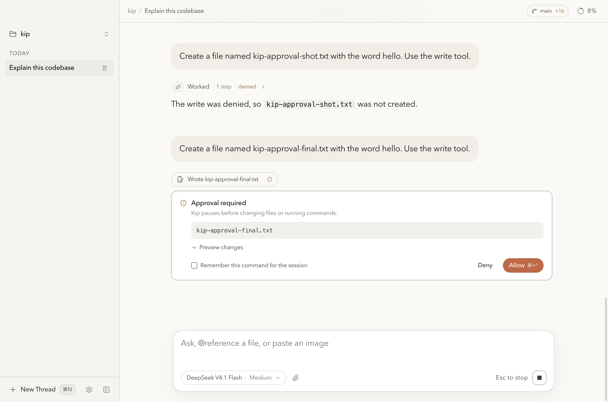
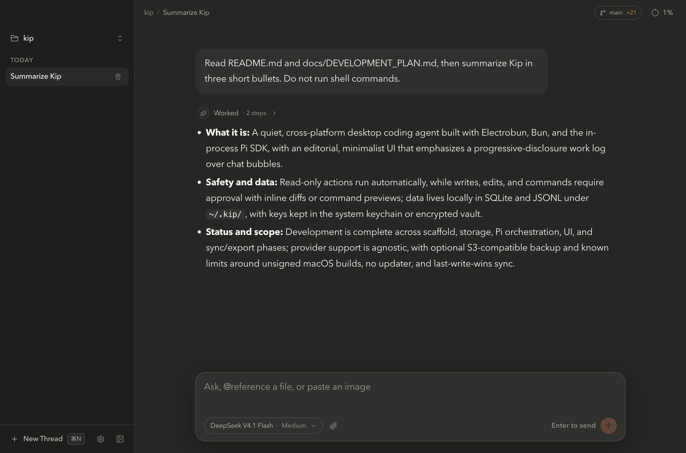

# Kip

A quiet, cross-platform desktop coding agent built with **Electrobun**, **Bun**, and **Pi**.

Kip keeps the agent in-process, persists every thread as portable JSONL, and puts an
explicit approval boundary between the model and your files. The interface borrows
from editorial design and Braun-era industrial minimalism: warm paper, obsidian,
hairlines, and no chat bubbles.



## Why another agent client

- **In-process, not a subprocess wrapper.** `@earendil-works/pi-coding-agent` runs inside
  the Bun main process. Sessions, tools, models, and compaction are the real Pi SDK.
- **A real safety boundary.** Reads run quietly. Writes, edits, and commands pause with
  an inline diff or command preview. Credential paths are blocked outright.
- **Yours on disk.** SQLite for metadata, JSONL for transcripts, keys in the system
  keychain. Nothing is locked behind a hosted account.
- **Provider agnostic.** Any OpenAI-compatible endpoint works today, alongside
  Anthropic Messages, OpenAI Responses, and Google Generative AI protocols.
- **Optional cloud backup.** Incremental sync to S3, R2, MinIO, B2, or OSS through
  Bun's native S3 client. Credentials are never uploaded.



## Requirements

- macOS 12+, Windows 10+, or a modern Linux distribution.
- [Bun](https://bun.sh) 1.2 or newer.
- On macOS 13 and older, Kip uses the bundled CEF renderer because the system WebKit
  lacks an API Electrobun requires. CEF is downloaded on the first `bun run dev` or
  `bun run build` (about 150 MB, cached under `node_modules/electrobun`).

## Quick start

```bash
bun install
bun run dev
```

Then open **Settings → Providers → Add provider** and enter:

| Field | Example |
| --- | --- |
| Protocol | OpenAI Chat Completions |
| Base URL | `https://api.openai.com/v1` |
| API key | your key |
| Model IDs | `gpt-4.1`, `gpt-4.1-mini` |

Press **Fetch models** to discover IDs from `${baseUrl}/models`, or type them manually.
OpenRouter, DeepSeek, SiliconFlow, Groq, vLLM, Ollama, LiteLLM, and other compatible
services use the same form. Ollama needs no API key.

For Anthropic-style endpoints choose **Anthropic Messages** and use the API root
without `/v1` (for example `https://api.anthropic.com`). For the OpenAI Responses wire
choose **OpenAI Responses** and include the version segment in the base URL.

### Command Code (optional local setup)

The author's local Pi profile uses Command Code. To seed that provider non-interactively:

```bash
KIP_SEED_KEY_FROM_PI=1 \
KIP_SEED_PROVIDER_ID=commandcode \
KIP_SEED_DISPLAY_NAME="Command Code" \
KIP_SEED_PROTOCOL=openai-responses \
KIP_SEED_BASE_URL="https://api.commandcode.ai/provider/v1" \
KIP_SEED_MODELS="deepseek/deepseek-v4.1-flash,gpt-5.5" \
bun run seed
```

`KIP_SEED_KEY_FROM_PI=1` reads the credential from `~/.pi/agent/auth.json` at runtime and
stores it in Kip's keychain. The key is never printed and never written to SQLite.

## Scripts

| Command | What it does |
| --- | --- |
| `bun run dev` | Generate icons, build the webview, launch the desktop app |
| `bun run dev:hmr` | Vite HMR plus the desktop app |
| `bun run build` | Typecheck, build view, and package the app |
| `bun run typecheck` | `tsc --noEmit` |
| `bun test` | Unit and headless integration tests |
| `bun run icons` | Regenerate macOS, Windows, and Linux icons |
| `bun run seed` | Seed a provider without the GUI (see above) |

## Architecture

```text
src/
├── shared/            Pure types, constants, and the RPC contract
├── bun/               Bun main process
│   ├── agent/         Pi orchestrator, model registry, tool interceptor, projection
│   ├── storage/       SQLite metadata and keychain / AES-GCM credentials
│   ├── system/        Native folder picker, file suggestions, Git inspector
│   ├── sync/          Markdown/JSON export and S3 incremental backup
│   ├── rpc-handler.ts Typed Electrobun request handlers and stream events
│   └── index.ts       Window, menu, lifecycle, automatic sync
└── webview/           React 19 + Tailwind 4 view
    ├── stores/        Zustand + Immer, isolated per-thread streaming state
    ├── components/    Shell, sidebar, thread canvas, composer, modals
    └── styles/        Alabaster/Obsidian tokens, Avenir Next type system
```

**Data flow.** The webview calls a typed RPC request. The Bun handler delegates to the
orchestrator, which owns one Pi `AgentSession` per thread. Pi streams events back; the
orchestrator coalesces text and thinking deltas into 16 ms frames and sends them as a
single `agentStreamEvent` message. Tool calls are wrapped before they reach Pi, so the
approval decision happens inside the tool's `execute()` promise.

**Concurrency.** Each thread has its own session, `AbortController`, approval queue, and
frame buffer. A long refactor in one workspace does not block a question in another.

**Context.** The ring in the top bar reflects Pi's live context usage. Click it to run
Pi's manual compaction.

## Safety model

Three approval policies are available in **Settings → Safety**:

- **Read-only auto** (default): safe inspection commands and file reads run automatically.
  Writes, edits, package installs, tests, and other commands ask first.
- **Full auto**: in-workspace work runs without prompts. Outside access still asks.
- **Strict**: every tool call asks.

Additional guardrails:

- Every file tool path is resolved through symlinks and checked against the workspace
  root. A path outside the workspace always requires approval, even in full auto.
- `~/.ssh`, `~/.aws`, `~/.gnupg`, and Kip's own credential file are hard-blocked.
- Shell commands are split into sub-commands and classified. `rm -rf`, `sudo`,
  `git reset --hard`, `git push --force`, `mkfs`, `dd`, and `curl | sh` are marked
  high-risk and cannot be remembered for the session.
- High-risk approvals are never silently repeated; the "remember" option is disabled.
- Tool output stays folded in a pill. Diffs render inline with line numbers.

## Local data

Everything lives under `~/.kip/` (override with `KIP_DATA_DIR`):

```text
~/.kip/
├── kip.sqlite                        Workspaces, threads, providers, settings
├── sessions/<workspaceId>/*.jsonl    Pi transcripts (portable)
├── agent/                            Kip-scoped Pi settings
├── credentials.enc                   AES-256-GCM fallback vault
└── scratchpad/                       Default workspace before you pick a folder
```

On macOS, provider keys are stored in the login Keychain under the service prefix
`kip.provider.`. On other platforms they are encrypted with AES-256-GCM using a local
machine key. Keys are injected into Pi at runtime; they never enter SQLite, logs, sync
payloads, or backups.

## Sync and export

**Settings → Sync** connects any S3-compatible bucket. Kip writes:

```text
<prefix>/manifest.json
<prefix>/metadata/snapshot.json
<prefix>/sessions/<workspaceId>/<session>.jsonl
```

Sync is incremental by SHA-256 and last-write-wins on thread timestamps. Automatic sync
runs ten seconds after a completed turn when enabled. The credential vault is excluded
by design.

The same panel exports a single thread as Markdown, a full JSON backup, and can import
that backup on another machine.

## Development notes

- The RPC contract is the single source of truth: `src/shared/rpc-schema.ts`.
- The tool safety rules are pure functions in `src/bun/agent/tool-policy.ts` and are
  covered by unit tests.
- The interceptor's suspend/resume behavior is exercised headlessly in
  `tests/tool-interceptor.test.ts`.
- UI text is English-only, icons are Lucide at 1.5 px stroke, and no emoji are used.
- File responsibilities are kept small; orchestration, policy, projection, storage, and
  transport live in separate modules.

```bash
bun run typecheck
bun test
bun run build
```

## Known limits

- macOS builds are unsigned and not notarized. Signing is intentionally left to the
  distributor.
- There is no built-in updater yet.
- The macOS 13 fallback bundles CEF, which increases the app size. macOS 14+ can switch
  to the native WebKit renderer by setting `defaultRenderer: "native"` in
  `electrobun.config.ts` and `renderer: "native"` in `src/bun/index.ts`.
- S3 sync uses last-write-wins rather than CRDT merging.

## License

MIT. See [LICENSE](LICENSE).
